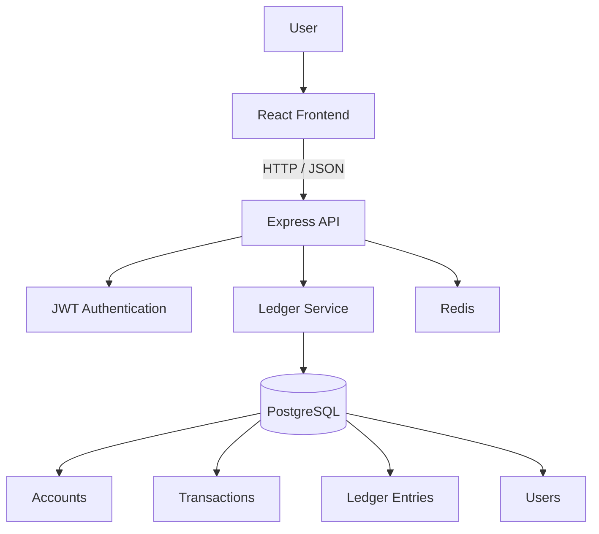

# System Architecture

## 1. Overview

Apex Ledger follows a client-server architecture with a React frontend, an Express and TypeScript backend, PostgreSQL for persistent financial data, and Redis for supporting fast application operations.

The backend is responsible for authentication, validation, transaction processing, and ledger integrity.

## 2. High-Level Architecture

## 3. Frontend

The frontend is built with React and TypeScript.

Responsibilities include:

- User registration and login
- Managing the authentication token
- Displaying account balances
- Creating accounts
- Initiating transfers, deposits, and withdrawals
- Displaying paginated transaction history
- Communicating with the backend through HTTP API requests

The frontend does not calculate authoritative account balances. It displays values returned by the backend.

## 4. Backend

The backend uses Express and TypeScript.

Its main responsibilities include:

- Processing API requests
- Authenticating users with JWTs
- Validating request data
- Enforcing account ownership
- Coordinating database transactions
- Applying idempotency checks
- Returning transaction and account information

The ledger service contains the core financial posting logic.

## 5. Database Design

PostgreSQL stores the persistent application data.

### Users

Stores user identity and authentication information.

### Accounts

Stores customer and system accounts, including currency and account type.

### Transactions

Stores transaction-level information such as amount, currency, type, status, and idempotency key.

### Ledger Entries

Stores the individual debit and credit entries associated with transactions.

The ledger entries are the source of truth for account balances.

## 6. Double-Entry Ledger

Every settled financial operation creates balanced ledger entries.

For example, a transfer of SGD 10 from Account A to Account B produces:

| Account | Ledger movement |
|---|---:|
| Account A | -SGD 10 |
| Account B | +SGD 10 |
| Net movement | SGD 0 |

The sum of the corresponding ledger movements is zero.

This design provides an auditable record of financial activity.

## 7. Transfer Processing

A transfer follows this general sequence:

1. Authenticate the user.
2. Validate the transfer request.
3. Verify ownership of the sender account.
4. Check the idempotency key.
5. Begin a PostgreSQL transaction.
6. Lock the affected accounts in deterministic ID order.
7. Calculate the sender's available balance from ledger entries.
8. Reject the transfer if funds are insufficient.
9. Insert the transaction record.
10. Insert the debit and credit ledger entries.
11. Mark the transaction as settled.
12. Commit the database transaction.

If an operation fails, the database transaction is rolled back.

## 8. Concurrency Protection

Concurrent transfers can attempt to spend the same available balance.

The system uses PostgreSQL row-level locking with `SELECT ... FOR UPDATE`.

Affected accounts are locked in deterministic order to reduce deadlock risk.

Balance validation and ledger posting happen within the same database transaction.

## 9. Idempotency

Financial requests can be retried because of network interruptions or client timeouts.

Idempotency keys help ensure that a repeated request does not create another financial posting.

The backend scopes transfer idempotency keys by user and checks whether an existing request matches the new request.

Redis is also integrated to support idempotency-related operations. PostgreSQL remains the durable record of financial transactions.

## 10. Deposits and Withdrawals

Deposits and withdrawals are represented as internal postings between a customer account and a matching system clearing account.

- Deposits credit the customer account and debit the clearing account.
- Withdrawals debit the customer account and credit the clearing account.

A matching clearing account must exist for the currency being used.

These operations simulate internal ledger movements; they do not initiate real-world payments.

## 11. Authentication and Security

The application uses:

- bcryptjs for password hashing
- JSON Web Tokens for authenticated API access
- Protected routes for account and transaction operations
- Account ownership checks
- Request validation
- HTTP security headers through Helmet
- Environment variables for secrets and connection settings

Production deployment requires additional security review and appropriate secret management.

## 12. Technology Summary

| Layer | Technology |
|---|---|
| Frontend | React, TypeScript, Vite |
| Styling | Tailwind CSS |
| Backend | Node.js, Express, TypeScript |
| Database | PostgreSQL |
| Cache / supporting operations | Redis |
| Authentication | JWT, bcryptjs |
| Testing | Vitest |
| API communication | HTTP / JSON |

## 13. Known Limitations

- No external bank or payment-provider integration
- No real-world settlement network
- Production deployment and infrastructure hardening remain outstanding
- Load and stress testing still require final verification
- Redis availability and recovery behavior require production-level operational testing